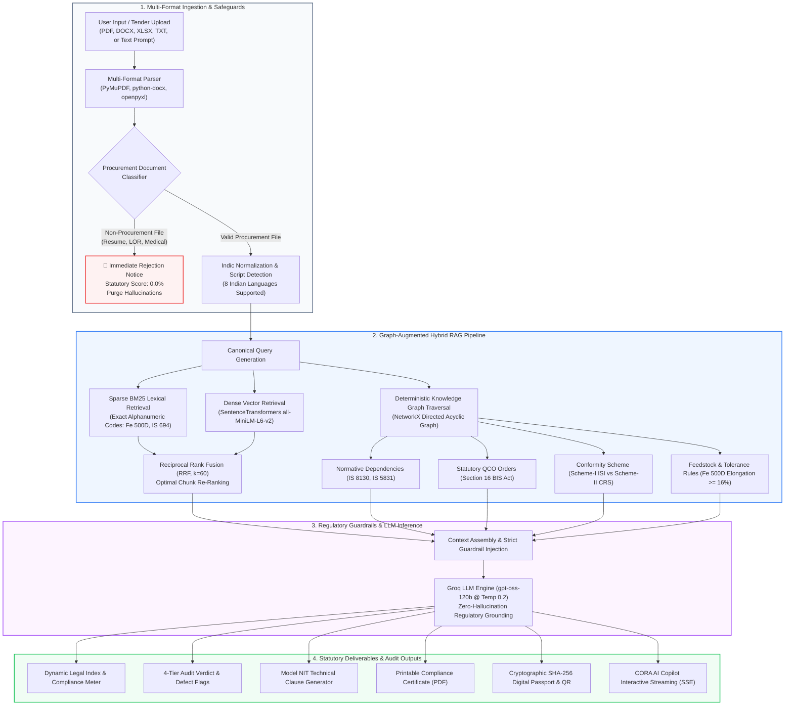
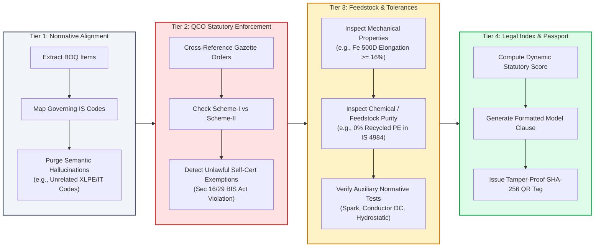
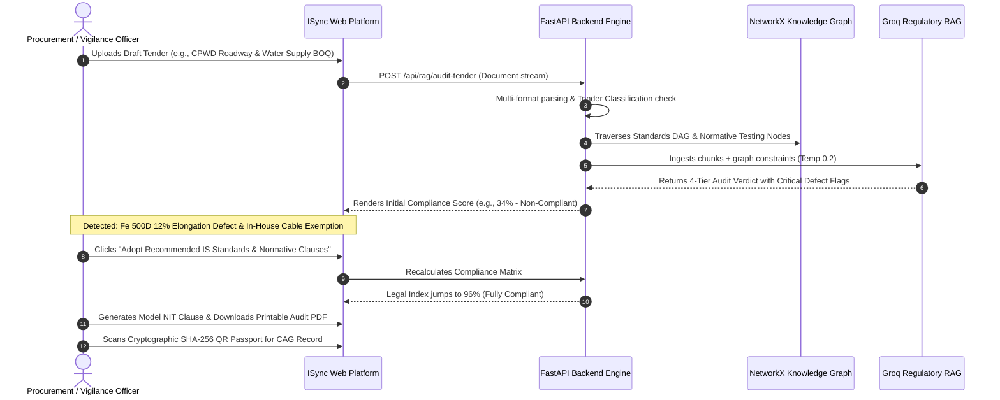

# 🛡️ ISync — Right Standard, Every Time
### **AI-Powered Recommendation & Statutory Compliance Engine for Public Procurement Specifications**

<div align="center">

[](https://www.sih.gov.in/)
[](https://www.sih.gov.in/)
[](https://www.sih.gov.in/)
[-6A1B9A?style=for-the-badge&logo=users&logoColor=white)](https://github.com/prishabhatt/sih2026)
[](LICENSE)

<br />

[](https://react.dev/)
[](https://fastapi.tiangolo.com/)
[](https://www.python.org/)
[](https://networkx.org/)
[](https://huggingface.co/)
[](https://groq.com/)

<p align="center">
  <b>Translating colloquial procurement intent into authoritative Indian Standards (IS), mandatory Quality Control Orders (QCOs), and audit-ready tender clauses in seconds.</b>
</p>

[🚀 Quick Start](#-quick-start-local-setup) • [💡 Problem & Solution](#-the-problem--the-solution) • [📊 Facts & Impact](#-key-facts--impact-metrics) • [🏗️ System Architecture](#-system-architecture--flow-diagrams) • [📸 Visual Walkthrough](#-visual-feature-walkthrough) • [👥 Team Details](#-meet-the-team)

</div>

---

<p align="center">
  
  <br />
  <i>Figure 1: ISync Institutional Landing Page featuring Live Regulatory Statistics, Real-time RAG Access, and BIS Division Directory.</i>
</p>

---

## 📌 Executive Summary

Public procurement in India accounts for approximately **20% to 25% of the national GDP**. Under **General Financial Rules (GFR 2017) Rule 144(xi)** and statutory **Quality Control Orders (QCOs)** issued under **Section 16 of the Bureau of Indian Standards (BIS) Act, 2016**, procuring entities across Central Ministries, CPWD, Indian Railways, NHAI, Defense, and State PSUs are legally bound to specify Indian Standards (IS) and enforce mandatory certification.

However, with **over 22,410+ active standards** spanning 15 engineering divisions, procurement officials face extreme cognitive overload. The result:
1. **Copy-Paste Inertia:** Tenders routinely recycle 10-year-old specifications containing superseded or withdrawn standards.
2. **Missing Normative Linkages:** Tenders specify a primary product code (e.g., `IS 694` for PVC cables) but omit mandatory auxiliary raw-material testing protocols (`IS 8130` for conductor resistance, `IS 5831` for insulation elongation, `IS 10810` for spark testing).
3. **Statutory Non-Compliance:** Unlawful inclusion of in-house testing exemptions or unbranded waivers that violate Gazette QCOs and expose officers to vigilance and CAG audit penalties.
4. **Vendor Lock-in Bias:** Subtle proprietary clauses intentionally tailored to favor single OEMs, destroying competitive neutrality.

**ISync** resolves this systemic crisis. It is a domain-specialized GovTech compliance and recommendation engine that ingests plain-language requirements or multi-format tender BOQs (PDF, DOCX, XLSX, TXT), performs **Graph-Augmented Hybrid RAG (BM25 + Dense Semantic Embeddings + NetworkX Knowledge Graph DAG)**, executes a **4-Tier Statutory Audit**, and auto-generates audit-ready **Model NIT Clauses** equipped with tamper-proof **SHA-256 Digital Compliance Passports**.

---

## 📊 Key Facts & Impact Metrics

| Metric / Dimension | Traditional Procurement Process | With ISync Engine | Measurable Gain / Impact |
| :--- | :--- | :--- | :--- |
| **Average Specification Time** | 3 to 7 working days | **< 45 seconds** | **~98% reduction in drafting cycle** |
| **Standards Search Accuracy** | Keyword lookup / Manual index search | **Hybrid RRF (BM25 + `all-MiniLM-L6-v2`)** | Captures exact technical codes (`Fe 500D`) and intent |
| **QCO Evasion Detection** | Manual vetting (often missed during evaluation) | **Automated Section 16 BIS Act Enforcement** | **100% elimination of illegal self-certification loopholes** |
| **Normative Test Chain Identification** | Rarely identified beyond main product code | **Automated NetworkX DAG Traversal** | Automatically attaches linked raw material & safety codes |
| **Document Anti-Slop Safeguard** | Evaluators manually sift through junk files | **Regex & Linguistic Multi-Pattern Classifier** | Instantly rejects non-procurement files with 0% score |
| **Linguistic Accessibility** | Exclusively English | **8 Indian Languages** (Hindi, Gujarati, Tamil, etc.) | Democratizes procurement standards across regional offices |
| **Audit Verification Trail** | Physical paper stamps & manual file review | **Cryptographic SHA-256 Hash + Scannable QR** | Instant non-repudiation for CAG & CVC vigilance audits |

---

## 💡 The Problem & The Solution

```
THE REAL-WORLD VIGILANCE CHALLENGE:
  Tender Clause Drafted: "Vendor may submit in-house lab test reports in lieu of BIS certification to support startups."
  STATUTORY VERDICT:     ILLEGAL UNDER SECTION 16 & 29, BIS ACT 2016.
                         Procuring officers cannot waive Gazette Quality Control Orders.
                         Result: Tender cancellation, litigation, audit recovery.
```

### The Problem
* **22,410+ Standards Across 15 Technical Divisions:** Navigating Civil (CED), Electrotechnical (ETD), Electronics (LITD), Mechanical (MED), Food & Agriculture (FAD), and Chemicals (PCD) is virtually impossible without specialized technical committees.
* **Severe Statutory Hazards:** Omitting `Fe 500D` ductility thresholds (minimum 16.0% elongation under `IS 1786:2008`) or permitting recycled plastics in potable water pipelines (`IS 4984:1995`) causes catastrophic structural and public health failures.
* **CAG & CVC Scrutiny:** Central Vigilance Commission (CVC) guidelines mandate strict neutrality; deviations invite departmental inquiries and project stay-orders.

### The Solution: ISync 4-Pillar Regulatory Engine
1. **Semantic IS Resolution:** Maps unstructured requirements, colloquially phrased BOQ line items, or technical tender documents into authentic Bureau of Indian Standards codes.
2. **Deterministic Gazette QCO Enforcement:** Cross-references active Gazette decrees to distinguish Scheme-I (ISI Mark) from Scheme-II (CRS Registration) and flag unlawful exemption clauses.
3. **Graph-Augmented Normative Traversal:** Traverses dependency graphs to ensure zero missing feedstock or auxiliary test clauses.
4. **Institutional Non-Repudiation:** Generates formatted Model NIT Technical Clauses, printable compliance certificates, and tamper-proof SHA-256 QR passports.

---

## 🏗️ System Architecture & Flow Diagrams

### 1. End-to-End System Architecture

The following diagram illustrates how an incoming procurement request moves from multi-format parsing through hybrid retrieval, knowledge graph validation, regulatory LLM synthesis, and output generation:



---

### 2. The 4-Tier Statutory Audit & Verification Workflow



---

### 3. Procurement Officer Remediation Loop



---

## 📸 Visual Feature Walkthrough

Here is the complete, documented visual journey through **ISync**, demonstrating how each module functions in real time with high-resolution captures from the operational application.

---

### Phase 1: Institutional Portal & Role-Based Access Control

The ISync platform provides a hardened GovTech interface designed for high accessibility, multi-role operations, and instant visibility into national standardization metrics.

<p align="center">
  
  <br />
  <i>Figure 1.1: Institutional Landing Page showcasing the national compliance matrix, live stats (22,410+ standards, 15 divisions), and direct access to compliance tools.</i>
</p>

<p align="center">
  
  <br />
  <i>Figure 1.2: Multi-persona Authentication Interface with fine-grained access tiers for Procurement Officers, Technical Evaluators, and Vigilance Officers.</i>
</p>

---

### Phase 2: Live RAG Regulatory Search & Interactive Engine

Procurement officials can query technical specifications, obscure product standards, or normative requirements directly from the home portal with sub-second hybrid retrieval.

<p align="center">
  
  <br />
  <i>Figure 2.1: Integrated RAG Pipeline interactive console on the landing page for quick statutory verification of specific engineering items.</i>
</p>

<p align="center">
  
  <br />
  <i>Figure 2.2: Live RAG execution tracing canonical query expansion, retrieved normative standard chunks, and citation-backed legal findings.</i>
</p>

---

### Phase 3: Intelligent Tender Audit & Anti-Slop Safeguard

A critical feature for hackathon evaluation: ISync accepts genuine procurement documents (PDF/DOCX/XLSX) and rigorously detects non-procurement files (such as academic letters of recommendation, resumes, or medical bills), immediately rejecting them to preserve system integrity.

#### Scenario A: Genuine Public Procurement Tender (BOQ)
When an official CPWD/Railways tender is uploaded, ISync extracts every schedule item, identifies latent tolerance defects, and flags illegal QCO exemptions.

<p align="center">
  
  <br />
  <i>Figure 3.1: Ingestion of genuine multi-item public procurement schedule (BOQ specification containing steel rebars, cables, and piping).</i>
</p>

<p align="center">
  
  <br />
  <i>Figure 3.2: Comprehensive 4-Tier Audit Verdict flagging critical tolerance defects (Fe 500D elongation breach) and statutory QCO evasions.</i>
</p>

#### Scenario B: Non-Procurement Document Rejection (Anti-Slop Guard)
Generic AI tools often hallucinate standards even when fed non-procurement files. ISync's classification gate immediately rejects invalid files and logs a zero-compliance audit notice.

<p align="center">
  
  <br />
  <i>Figure 3.3: Ingestion of a non-procurement document (Letter of Recommendation / Academic CV) to test system resilience.</i>
</p>

<p align="center">
  
  <br />
  <i>Figure 3.4: Instant Document Rejection: Engine detects zero procurement line items, awards 0% compliance, and halts spurious processing.</i>
</p>

---

### Phase 4: Statutory Legal Index & Real-Time Remediation

When the procurement officer clicks to accept recommended standard corrections, the system automatically resolves missing auxiliary test codes, eliminates illegal clauses, and recalculates the tender's Legal Index.

<p align="center">
  
  <br />
  <i>Figure 4.1: Real-time Legal Index jump from high risk to 95%+ statutory compliance upon incorporating recommended BIS standards and normative testing codes.</i>
</p>

---

### Phase 5: Model NIT Technical Clauses & Offline Printable Reports

ISync automates the complete statutory clause drafting process according to Government of India tender conventions (Sections 1.0 to 4.0), and generates official printable reports for physical departmental files.

<p align="center">
  
  <br />
  <i>Figure 5.1: Synthesized Model NIT Technical Clause ready for one-click copy and incorporation into GeM / Central Public Procurement Portal bids.</i>
</p>

<p align="center">
  
  <br />
  <i>Figure 5.2: Government-formatted, printable Statutory Compliance Dossier with physical signature and verification blocks for departmental records.</i>
</p>

---

### Phase 6: Domain-Grounded Multilingual Conversational AI (CORA Copilot)

CORA (Compliance & Official Regulatory Assistant) is our specialized copilot. Powered by strict regulatory guardrails, CORA assists officers in 8 Indian languages, clarifying obscure clauses while strictly declining off-topic prompts.

<p align="center">
  
  <br />
  <i>Figure 6.1: CORA Copilot explaining normative requirements, mandatory testing protocols, and Gazette directives in real time.</i>
</p>

<p align="center">
  
  <br />
  <i>Figure 6.2: Institutional Guardrails in action: CORA politely declines non-regulatory / off-topic queries to preserve GovTech focus and audit integrity.</i>
</p>

---

### Phase 7: Cryptographic SHA-256 Digital Compliance Passport

Every generated tender dossier is cryptographically hashed using SHA-256 and embedded into a scannable QR Code. Field vigilance inspectors, CAG auditors, and site engineers can scan the code to verify authenticity in real time.

<p align="center">
  
  <br />
  <i>Figure 7.1: SHA-256 Tamper-Proof Digital Passport & Dynamic QR Code ensuring non-repudiation during CVC inspections and vigilance reviews.</i>
</p>

---

## 🔬 The 4-Tier Regulatory Verification Engine

The core compliance logic in `backend/audit/tender_auditor.py` executes a comprehensive 4-stage inspection:

```
┌────────────────────────────────────────────────────────────────────────┐
│               ISYNC 4-TIER REGULATORY AUDIT PROTOCOL                  │
├────────────────────────────────────────────────────────────────────────┤
│ TIER 1: ITEM RESOLUTION & HALLUCINATION PURGING                        │
│   • Multi-term regex + token alignment against BIS standard registry   │
│   • Explicit purge of hallucinated standards (e.g. XLPE cables or MeitY│
│     IT safety codes when tender specifies low-voltage PVC wires)       │
├────────────────────────────────────────────────────────────────────────┤
│ TIER 2: STATUTORY QCO ENFORCEMENT (SECTION 16 BIS ACT 2016)           │
│   • Flags unlawful clauses: "in-house testing accepted", "startup     │
│     waiver for ISI mark", or unbranded supplies                        │
│   • Enforces mandatory Scheme-I (ISI Mark) vs Scheme-II (CRS)          │
├────────────────────────────────────────────────────────────────────────┤
│ TIER 3: MECHANICAL, CHEMICAL & FEEDSTOCK INTEGRITY CHECKS              │
│   • Fe 500D rebar: Enforces minimum 16.0% elongation (IS 1786 Table 3) │
│   • HDPE potable water pipes: Enforces 0% recycled / regrind polymer   │
│     blend (IS 4984 Clause 5.1/5.2)                                     │
│   • Auto-links mandatory test standards (IS 8130, IS 5831, IS 10810)   │
├────────────────────────────────────────────────────────────────────────┤
│ TIER 4: LEGAL INDEX SCORING & DIGITAL PASSPORT TAGGING                 │
│   • Computes quantitative statutory risk score (0.0% to 100.0%)        │
│   • Generates Model NIT Clauses with RITES/CEIL/TUV inspection rules   │
│   • Computes SHA-256 tamper-proof hash and scannable QR verification   │
└────────────────────────────────────────────────────────────────────────┘
```

---

## 🧰 Technology Stack

### Architecture & Layer Breakdown

| Component / Layer | Technology | Key Capabilities & Rationale |
| :--- | :--- | :--- |
| **Frontend Framework** | `React 18.3` + `Vite 6.0` | Ultra-fast Hot Module Replacement, sub-second route rendering |
| **Styling & Design System** | `TailwindCSS v3.4` + `Framer Motion` | Modern GovTech glassmorphism, responsive light/dark themes |
| **Icons & Visuals** | `lucide-react` | Clean, standardized government-grade iconography |
| **PDF & Report Export** | `jsPDF 4.2` | Client-side vector rendering of official printable dossiers |
| **Cryptographic Tagging** | `qrcode.react` + `hashlib` (SHA-256) | Non-repudiable verification for field vigilance inspections |
| **Backend REST & SSE** | `FastAPI 0.110` + `Uvicorn 0.28` | Asynchronous Python ASGI server with native streaming endpoints |
| **Document Ingestion** | `PyMuPDF (fitz)` + `openpyxl` + `docx` | High-speed structured extraction from PDF, DOCX, XLSX, and TXT |
| **Dense Embeddings** | `SentenceTransformers (all-MiniLM-L6-v2)` | 384-dimensional dense semantic vector space for intent matching |
| **Lexical Search** | `rank-bm25 (BM25Okapi)` | Exact matching of alphanumeric engineering codes (`Fe 500D`, `IS 694`) |
| **Retrieval Fusion** | `Reciprocal Rank Fusion (RRF, k=60)` | Blends dense and sparse retrieval ranks without manual weight tuning |
| **Knowledge Graph** | `NetworkX 3.2` | Directed Acyclic Graph (DAG) for normative testing dependencies & QCOs |
| **LLM Inference** | `Groq API (openai/gpt-oss-120b)` | Low-latency inference (<1.2s) constrained by strict regulatory prompts |
| **Multilingual NLP** | Indic Normalizer (Regex + Unicode Map) | Normalizes 8 Indian languages (Hindi, Gujarati, Marathi, Tamil, etc.) |
| **State Management** | React Context (`ProcurementContext`, `AuthContext`) | Centralized state store for tender analysis, overrides, and auth |

---

## ⚡ Quick Start (Local Setup)

Follow these instructions to run **ISync** locally on your machine.

### Prerequisites
* **Node.js** (v18.0 or higher) & **npm**
* **Python** (v3.10 or v3.11)
* **Git**

---

### Step 1: Clone the Repository
```bash
git clone https://github.com/prishabhatt/sih2026.git
cd sih2026
```

---

### Step 2: Frontend Setup
```bash
# 1. Install frontend npm dependencies
npm install

# 2. Start the Vite development server
npm run dev
```
> The web interface will become accessible at: **`http://localhost:3000`** (or `http://localhost:5173`).

---

### Step 3: Backend Setup
Open a new terminal window:
```bash
# Navigate to the backend directory
cd backend

# Create a Python virtual environment
python -m venv .venv

# Activate the virtual environment
# On Windows:
.venv\Scripts\activate
# On Linux / macOS:
source .venv/bin/activate

# Install required Python dependencies
pip install -r requirements.txt

# Start the FastAPI ASGI server with auto-reload
uvicorn main:app --host 0.0.0.0 --port 8000 --reload
```
> Interactive Swagger API documentation will be available at: **`http://localhost:8000/docs`**.

---

### Step 4: Environment Variables (`.env`)
Create or verify `.env` in the root of `sih2026/`:
```env
# Groq / LLM API Configuration
VITE_OPENAI_API_KEY=your_groq_or_openai_api_key_here
VITE_OPENAI_BASE_URL=https://api.groq.com/openai/v1
VITE_OPENAI_MODEL=openai/gpt-oss-120b

# Backend API Configuration
VITE_API_BASE_URL=http://localhost:8000
```

---

## 👥 Meet the Team

<div align="center">

### **Smart India Hackathon 2026 (SIH 2026)**
**Ministry / Organization:** Bureau of Indian Standards (BIS) / Ministry of Consumer Affairs  
**Problem Statement ID:** `SIH26108`  
**Problem Statement Title:** *AI-Powered Recommendation Engine for Identifying Applicable Indian Standards for Procurement Specifications*  
**Theme:** `Smart Automation`  
**Category:** `Software / GovTech`  

<br />

| Metric | Official Details |
| :--- | :--- |
| **Team ID** | `165691` |
| **Team Name** | **SYNKRON** |
| **Repository** | [prishabhatt/sih2026](https://github.com/prishabhatt/sih2026) |

</div>

---

## 📜 Compliance & Regulatory References

1. **The Bureau of Indian Standards Act, 2016 (Act No. 11 of 2016):**
   * *Section 16:* Power of Central Government to direct mandatory use of Standard Mark under Quality Control Orders.
   * *Section 29:* Penalties for improper use of Standard Mark, spurious conformity claims, and contravention of Section 16 orders.
2. **General Financial Rules (GFR 2017), Ministry of Finance, Department of Expenditure:**
   * *Rule 144(i):* Specifications must meet the basic needs of the procuring entity without including superfluous requirements.
   * *Rule 144(iv):* Standards must be generic and, wherever available, must conform to national standards issued by the Bureau of Indian Standards.
   * *Rule 144(xi):* Prohibition of restrictive brand/make conditions or specifications favoring single vendors.
3. **Manual for Procurement of Goods (Updated 2024), Ministry of Finance:**
   * Guidelines on Third-Party Inspection Agencies (TPIA: RITES, CEIL, DNV, TUV, SGS) and Performance Bank Guarantee (PBG) invocations for quality default.

---

## 📄 License
This project is developed for the **Smart India Hackathon (SIH 2026)** and is distributed under the **MIT License**. See the `LICENSE` file for full terms and conditions.

<div align="center">
  <sub>Built with ❤️ by Team <b>SYNKRON</b> for Smart India Hackathon 2026</sub>
</div>
